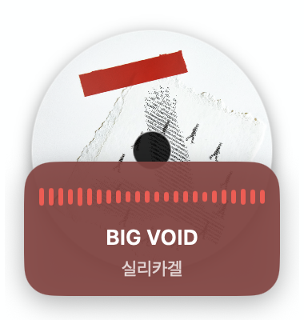

# NowSpinning

Spotify에서 재생 중인 곡을 화면 맨 위에 항상 떠 있는 CD 위젯으로 보여주는 macOS 앱.
앨범 커버가 CD처럼 돌아가고, 아래에 곡 정보와 실제 소리에 반응하는 파형이 표시됩니다.

<p align="center"></p>

## 위젯 소개

**회전하는 CD** — 재생 중인 곡의 앨범 커버가 CD 전체를 채우고 천천히 돌아갑니다. 일시정지하면 멈추고, 곡이 바뀌면 커버도 바뀝니다.

**실시간 파형** — Spotify가 내는 소리를 직접 읽어 24개의 막대로 그립니다. 볼륨이 작아도 자동으로 보정되어 항상 살아 움직입니다. 오디오 권한을 주지 않으면 소리와 무관한 애니메이션으로 대체됩니다.

**곡에 맞춰 바뀌는 색** — 커버에서 가장 선명한 색을 뽑아 정보 박스와 파형 색으로 씁니다. 곡이 바뀔 때마다 위젯 분위기도 바뀝니다.

**항상 맨 위** — Chrome, 전체화면 앱, 다른 데스크톱 어디에서든 위젯이 가려지지 않습니다. 배경이 없어 화면을 거의 가리지 않습니다.

**조작** — 드래그로 원하는 위치에 두고, 클릭하면 Spotify가 열리거나 맨 앞으로 옵니다. 메뉴바의 CD 아이콘에서 업데이트와 종료를 할 수 있습니다.

## 요구사항

- macOS 14.2 이상, Apple Silicon
- Spotify 데스크톱 앱
- Xcode Command Line Tools (`xcode-select --install`)

## 설치

```sh
brew install --cask chosim-dvlpr/tap/now-spinning
```

업데이트는 `brew upgrade --cask now-spinning` 또는 메뉴바 아이콘의 "업데이트 설치"로 할 수 있습니다.

## 소스에서 빌드

```sh
git clone https://github.com/chosim-dvlpr/now-spinning.git
cd now-spinning
./build.sh
open NowSpinning.app
```

## 권한

처음 실행하면 두 가지 권한을 묻습니다.

| 권한 | 용도 | 거부하면 |
|---|---|---|
| Spotify 제어 (Automation) | 곡 제목, 아티스트, 커버, 재생 상태 읽기 | 위젯이 동작하지 않음 |
| 시스템 오디오 녹음 | 파형을 실제 소리에 맞춰 그리기 | 소리와 무관한 애니메이션 파형으로 대체 |

오디오는 Spotify 프로세스의 출력만 읽으며, 저장하거나 외부로 전송하지 않습니다.
네트워크 요청은 Spotify가 알려주는 앨범 커버 이미지(HTTPS) 다운로드뿐입니다.
권한을 바꾼 뒤에는 앱을 다시 실행하세요.

## 구현 메모

- 네이티브 Swift + SwiftUI. Xcode 프로젝트 없이 `swiftc`로 `.app` 번들 생성, ad-hoc 서명 + hardened runtime
- 곡 정보는 AppleScript로 1초마다 폴링
- 파형은 CoreAudio 프로세스 탭(macOS 14.2+)으로 Spotify 오디오만 캡처. 화면 기록 권한 불필요
- 권한 프롬프트를 띄우기 위해 비공개 `TCC.framework`의 `TCCAccessRequest`를 호출합니다. 공개 API로는 탭 생성 시 프롬프트가 뜨지 않고 무음만 오기 때문입니다. macOS 업데이트로 막힐 수 있습니다.
- 샌드박스 비활성. App Store 배포 불가
