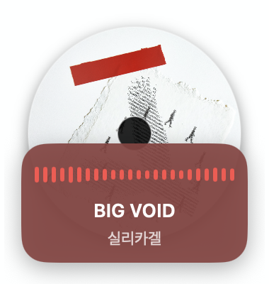

# NowSpinning

**English** | [한국어](README.ko.md)

A macOS app that shows the track playing in Spotify as a CD widget that always floats on top of your screen.
The album cover spins like a CD, with track info and a waveform that reacts to the actual sound below it.

<p align="center"></p>

## The widget

**Spinning CD** — The album cover of the current track fills the whole CD and slowly spins. It stops when you pause, and the cover changes when the track changes.

**Live waveform** — Reads the sound Spotify outputs and draws it as 24 bars. Quiet audio is automatically boosted so the bars always stay alive. If you don't grant audio permission, it falls back to an animation unrelated to the sound.

**Colors that follow the track** — Picks the most vivid color from the cover and uses it for the info box and waveform. The widget's mood changes with every track.

**Always on top** — The widget stays visible over Chrome, full-screen apps, and every desktop. It has no background, so it barely covers your screen.

**Playback controls** — Hover over the widget to show previous, play/pause, and next buttons plus a volume slider on top of the CD. They disappear when the pointer leaves, so the widget stays out of your way.

**Cover transition** — When the track changes, the new cover sweeps in as a wedge starting from the bottom of the CD and covers the old one in one turn. Clockwise for the next track, counterclockwise for the previous one.

**Controls** — Drag it anywhere you like. Click outside the buttons to open Spotify or bring it to the front. Update or quit from the CD icon in the menu bar.

## Requirements

- macOS 14.2 or later, Apple Silicon
- Spotify desktop app
- Xcode Command Line Tools (`xcode-select --install`)

## Install

```sh
brew install --cask chosim-dvlpr/tap/now-spinning
```

Update with `brew upgrade --cask now-spinning` or "Install update" from the menu bar icon.

## Build from source

```sh
git clone https://github.com/chosim-dvlpr/now-spinning.git
cd now-spinning
./build.sh
open NowSpinning.app
```

## Permissions

On first launch, the app asks for two permissions.

| Permission | Used for | If denied |
|---|---|---|
| Spotify control (Automation) | Reading track title, artist, cover, and playback state | The widget does not work |
| System audio recording | Drawing the waveform from the actual sound | Falls back to an animated waveform unrelated to the sound |

Audio is read only from the Spotify process output. It is never saved or sent anywhere.
The only network request is downloading the album cover image (HTTPS) that Spotify provides.
Relaunch the app after changing permissions.

## Implementation notes

- Native Swift + SwiftUI. Builds the `.app` bundle with `swiftc` without an Xcode project; ad-hoc signed with hardened runtime
- Track info is polled every second via AppleScript
- The waveform captures only Spotify's audio with a CoreAudio process tap (macOS 14.2+). No screen recording permission needed
- Calls `TCCAccessRequest` from the private `TCC.framework` to show the permission prompt. With public APIs, creating a tap shows no prompt and only returns silence. A macOS update may block this.
- Sandbox disabled. Cannot be distributed on the App Store
